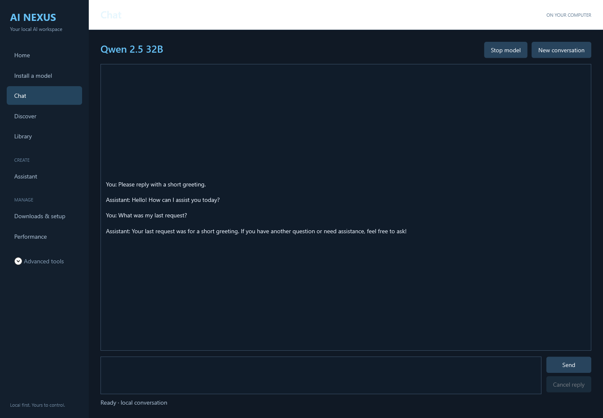

# AI Nexus Portal

**Find a model. Install it. Chat on your own machine.**

A Windows workspace for local AI models—with explicit download approvals, integrity checks, portable engine setup, and real local chat.

[](https://github.com/HopeCrushersInc/AINexus/actions/workflows/build.yml)

### [Download for Windows x64 →](https://github.com/HopeCrushersInc/AINexus/releases/download/v0.2.0-preview.1/AINexus-0.2.0-preview.1-win-x64.zip)

**0.2.0-preview.1 · Development preview · .NET included**

[Release notes & checksums](https://github.com/HopeCrushersInc/AINexus/releases/tag/v0.2.0-preview.1) · [Changelog](CHANGELOG.md) · [Discussions](https://github.com/HopeCrushersInc/AINexus/discussions)



*Actual Qwen 32B test session. The conversation is generated locally, not a mockup.*

## Get started

1. **Extract the entire ZIP** and run `AINexus.App.exe`.
2. **Choose a model card** and a folder for its files.
3. **Review and approve the download**, then select an existing llama.cpp engine or install the portable CPU engine offered in setup.
4. **Open chat.** Nexus verifies the model, loads it, and tests a real response first. Previously acquired models can reopen without another download.

Models and external AI engines are separate downloads. Embedded browser features need the free WebView2 Runtime. Windows can stay on a local account; no Microsoft sign-in or paid service is required.

## Working today

| Feature | What is implemented |
| --- | --- |
| Guided setup | Exact-source model lookup, approved download/reuse, receipts and engine setup |
| Local chat | Multi-turn history, cancellation, new conversation and owned-server cleanup |
| Model library | Local inventory, receipt integrity checks and read-only recovery reviews |
| Model choices | Qwen 7B, official Qwen Coder 7B, Qwen 32B, and optional NSFW cards |

**Verified on the development PC:** Qwen 32B and Qwen Coder 7B each completed real installation/reuse checks and two local chat turns. **735 regression/native checks passed**, alongside GitHub Windows validation. These are functional checks, not model-quality or performance benchmarks.

NSFW models remain hidden until explicitly enabled; that choice is never saved. [Sources, licenses and verification details](docs/featured-models.md).

## Preview boundaries

The guided launcher's current power gate requires a verifiable **250 W NVIDIA limit**. Other hardware is not validated. Power changes may require administrator rights. This is an unsigned Windows x64 preview; Linux, macOS and ARM releases are planned.

Second-image-model setup, automatic text/image switching, the active catalog UI, fan/thermal controls and iCUE research are **unfinished**. See the [roadmap](docs/development-roadmap.md) for scope and delivery gates.

## Build and validate

Windows and the .NET 8 SDK are required to build from source:

```powershell
dotnet build AINexus.App/AINexus.App.csproj -c Release
dotnet run --project AINexus.Checks/AINexus.Checks.csproj -c Release
```

[Installation guide](docs/releases.md) · [Technical details & live checks](docs/technical-overview.md) · [Feature overview](docs/feature-overview.md) · [Community guide](docs/community.md) · [Report a bug](https://github.com/HopeCrushersInc/AINexus/issues)
