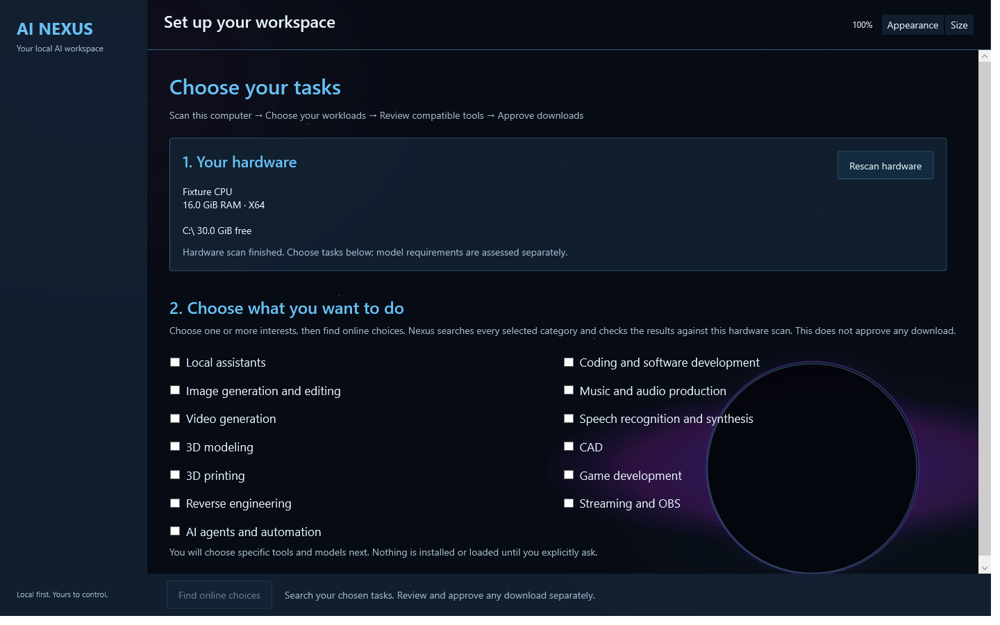

# Using AI Nexus

**Your hardware. Your workflow. Your choice.**

AI Nexus scans the computer, shows workload categories, and searches live internet sources after the user asks. It does not choose a model, promote a provider, or install software automatically.

### [Download for Windows x64](https://github.com/HopeCrushersInc/AINexus/releases/download/v0.2.0-preview.20/AINexus-0.2.0-preview.20-win-x64.zip)

**0.2.0-preview.20 · Development preview**

[Release notes & checksums](https://github.com/HopeCrushersInc/AINexus/releases/tag/v0.2.0-preview.20) · [What works / what is unfinished](project-status.md) · [Changelog](../CHANGELOG.md) · [Discussions](https://github.com/HopeCrushersInc/AINexus/discussions)



*Startup regression-check capture using fixture hardware. Categories are visible and unchecked; no model is selected.*

[Back to the project](../README.md)

## The workflow

1. **Open Nexus.** It scans local hardware; no software is installed or started.
2. **Choose your tasks.** Coding, art/images, music/audio, video, speech, 3D, CAD, 3D printing, game development, reverse engineering, streaming, assistants and agents are visible. Nothing is checked or remembered.
3. **Find online choices.** Confirming the checked tasks searches every selected category using the startup hardware snapshot. All returned models, tools and runtimes are visible by default, including unknown or unmet requirements and missing installation recipes. The optional **Show only estimated-fit results** filter narrows the list; it starts unchecked. Estimated-fit results appear first, preserving source order within each assessment group. No result is preselected or labeled “best.” A category or query can narrow a later search.
4. **Choose a result.** Inspect the actual source, license and available evidence. Unknown information stays unknown.
5. **Approve a specific action.** Supported download/install recipes require review and explicit approval. Configuration and launch remain separate actions.

## What is available

| Area | Current behavior |
| --- | --- |
| Text/coding model discovery | Popular, trending and recent GGUF sources; pinned artifacts, reported parameters/dates and separate memory/storage estimates |
| Reported benchmark evidence | Explicit exact-repository lookup, private saved snapshots and offline loading; reported scores and source-verification flags remain distinct from Nexus evaluation |
| Image discovery | Live pinned Safetensors artifact metadata plus tool repositories; image files remain unverified candidates |
| Video discovery | Live pinned text-to-video and image-to-video repository candidates plus tools; complete model files, runtime setup and hardware fit are unverified |
| Other workload discovery | Live public tool-repository metadata; install adapters vary and are explicitly identified |
| Persistent catalog and Library | SQLite source catalog, merged task categories, offline browsing and private acquisition-receipt links |
| Supported data acquisition | Explicit GGUF and image-Safetensors file reviews, exact approval, size/SHA-256 verification, private receipts and no conflicting overwrite |
| Runtime and local use | Explicit engine setup, local chat, image-engine configuration and owned-process controls |

**Discovery is not installation. A search result is not a recommendation or proof of compatibility.** Automated installation is currently limited to implemented recipes; finding an art or music tool does not mean its installer is supported.

Text searches combine Hugging Face **popular, trending and recently updated text-generation GGUF** listings. Broad coverage interleaves those lists and deduplicates repositories; the optional search view can request one order instead. Confirmed text workloads and the native text search request up to **48 results**, with no runtime software inserted into model choices, from at most **24 inspected repositories** with four concurrent reads and a 60-second deadline. A failed feed preserves successful results. Source ordering is preserved within hardware-assessment groups; no combined quality score is invented.

Results show source-reported repository parameters, update dates and downloads when available. These are repository facts, not proof of an artifact's architecture, release date, quality or speed. No parameter count is guessed from a filename. Use a model/publisher term or explicitly browse a selected repository's standalone files to inspect more quantizations. Named projectors, importance matrices, draft models and adapters are excluded from primary-model discovery; complete split GGUF sets and pagination are not supported yet. Search coverage remains bounded. The [official Hub API](https://huggingface.co/docs/hub/en/api) documents the metadata source; independent task evaluations remain separate unfinished work.

**Benchmark evidence** opens a selected text model's exact repository without contacting the internet. **Read public evaluations** explicitly retrieves its reported benchmark/task values, dates, attribution, source-verification flags and submission PR numbers. When a catalog folder is configured, the original source snapshot is saved privately beside it for offline review. **Load saved evidence** reads that repository's saved snapshot without contacting the internet or falling back to an online lookup. Original retrieval dates remain visible; saved evidence may be stale. A save failure preserves usable live results with a warning. Corrupt saved files are preserved and reported, rather than silently refreshed.

You can also enter another exact repository to inspect it separately. Missing rows remain unknown; upstream scores are never substituted for quantized-file measurements. Parsing is limited to 32 inspected rows; evaluated weights and quantization equivalence are not established. External attribution links are displayed as data and are not fetched automatically. Changing the selected model or repository revokes stale responses. Model choices and approvals are not saved. See [Hugging Face evaluation semantics](https://huggingface.co/docs/hub/eval-results). Comparable benchmark ranking, independent Nexus evaluation and a normalized benchmark catalog remain unfinished.

Download size and selected-drive space are shown separately from the conservative runtime-memory estimate. A file can fit on disk and still exceed the assessed available RAM/VRAM. Text models may qualify through system RAM when full GPU offload does not fit; partial CPU/GPU offload and disk-backed execution remain unassessed, and no speed is promised.

Image discovery searches public Hugging Face text-to-image repositories for bounded root Safetensors candidates and also lists GitHub tools. Pinned file sizes, hashes and licenses are shown when supplied. Image file candidates appear with an explicit unverified notice; a file may be a component or adapter, and its hardware fit and complete checkpoint contents are not established. The **Available action** column distinguishes **Review image file download** from **View source / manual setup**. Most generator tools still require manual setup. The exact official ComfyUI result can open an archive-download review; this is not engine installation. Other tool reviews keep source details visible in Discover. **Open source page** opens the selected public page only when clicked and approves no download or installation.

To acquire a supported image file, select its result and **Review selected item**, then **Choose existing folder → Review exact file download → approve the displayed source/license/plan → Download approved file**. The destination starts blank. Transfer verifies exact bytes and SHA-256, or rehashes a matching existing file when the review permits reuse. This acquires model data; it does not install a generator or prove that the checkpoint runs. After completion, **Choose tool / connect folder** returns to image-tool discovery if you have not chosen an engine. Only an explicitly chosen supported adapter can open its separate folder-configuration review.

Video searches both Hugging Face **text-to-video** and **image-to-video** feeds, interleaves and deduplicates their repositories, and adds a separate GitHub tool search. It inspects at most four repositories per task and eight repositories total, with at most eleven metadata requests and no pagination. Exact publisher/repository queries inspect that source directly. A video candidate has a pinned repository/model-card source, task and available license metadata, **not a fabricated complete-file inventory or download size**. Video models may require multiple components and dedicated runtimes; video download, installation and generation recipes are not integrated. **Inspect video pipeline / manual setup** exposes those limits without assigning video GGUF files to the text runtime. Nexus does not apply text-model memory estimates to image or video candidates.

The new Library keeps saved source facts separate from private local receipts. Browsing and filtering do not contact the internet, rehash large models, install software or start engines. A receipt means an acquisition was recorded; current integrity and successful offline execution need their own checks. See [catalog design and storage](catalog.md).

Supported GGUF models can also be opened from Library: choose the model, select its exact installed copy, review the saved source and local path, then explicitly load it with an existing engine. Local review starts no download or engine. Loading checks the current file hash and hardware capacity before testing generation and opening chat.

Image folders can be connected to an existing portable ComfyUI engine through a **separate review and approval**. The review shows the exact folders, configuration contents, existing file hash and recovery backup. Applying writes only the dedicated configuration; the original engine YAML stays unchanged. It affects the **next explicit engine start**, then you refresh the checkpoint list and choose a model yourself. Installed folder configuration persists; workload/model choices and approvals are never restored.

Images offers session-only width and height controls from **256 to 1024 pixels**, in multiples of 64. Explicit local generation was verified with SD1.5 at 512×512 and SDXL Base at 1024×1024 using the existing ComfyUI engine and both folder configurations. These are specific tested combinations, not default model choices or a guarantee for every checkpoint, size and computer.

Image discovery combines popular, trending and recent public source lists, then inspects up to 24 unique repositories. It does not pin a model family. Changing category clears the previous result list, category-specific search terms, fit-only filter and idle approvals. A blank Images search therefore starts fresh; enter terms to narrow it, or select a result and use **Browse selected model's files** for its exact repository. Older narrow image-search caches are preserved under separate keys.

## Appearance and controls

The simpler Home screen uses task and action buttons over a black-hole backdrop. Standard is the startup appearance. The **Appearance** menu offers Standard, LCARS, Cyberpunk, Midnight, Ocean, Forest, Ember, Graphite, Paper and Terminal. Paper provides a light reading surface, Graphite a quiet neutral surface and Terminal a monospace grid; the space styles keep the black-hole backdrop. Hold **Shift** while clicking LCARS to reveal the hidden Retro style. Appearance is session-only.

Hold **Shift** and scroll the mouse wheel to resize text and buttons from **75% to 175%**. The **Size** menu also offers smaller, larger and reset to 100%. Ordinary scrolling still scrolls. Use the native title bar to drag the window and any edge or corner to resize it.

## Preview limits

Windows x64 only. .NET is bundled; models and external engines are separate. Embedded web interfaces need WebView2. Nexus leaves GPU power settings unchanged unless the user explicitly applies a supported per-card limit in Performance. There is no universal wattage or NVIDIA power-control requirement for model launch. Other platforms, broader image installation, automatic server switching, thermal/fan controls and iCUE investigation remain unfinished.

Windows stays on its local account. No purchase or Microsoft sign-in is required. Existing model chat tests are recorded as validation examples, not promoted or preferred choices.

## Build and validate

```powershell
dotnet build AINexus.App/AINexus.App.csproj -c Release
dotnet run --project AINexus.Checks/AINexus.Checks.csproj -c Release
```

[Installation guide](releases.md) · [Technical details](technical-overview.md) · [Roadmap](development-roadmap.md) · [Community](community.md) · [Report a bug](https://github.com/HopeCrushersInc/AINexus/issues)

## Get a ComfyUI archive

In **Images**, choose **Find image tools**. Search online and select the tool you want. Only if you select the exact official ComfyUI tool, its details offer **Review archive download** as an optional action. Click **Check releases**, select an archive yourself, choose an existing folder, then review and approve the exact download. **Read source terms** opens the chosen release license. Downloading verifies size and SHA-256, preserves conflicting files and records a private receipt. Nothing is extracted or started. GPU/driver compatibility and bundled dependency terms still need separate review; integrated extraction and engine verification are unfinished.

## No preinstalled AI tools

The portal package includes its application dependencies, not AI engines, model weights or generator archives. Images starts with a neutral tool-discovery screen. Selecting an image workload does not select ComfyUI or any other engine. Selecting a source shows that tool's own actions; unsupported tools remain manual choices. Existing model and engine paths are not restored as startup selections. Previously approved files and saved configuration remain on disk.

## Inspect an acquired archive

After choosing a tool and reviewing its exact archive, **Inspect existing archive** is available for a local copy. A verified download also enables this action; it never runs automatically. Inspection rechecks size and SHA-256 and reads a typed 7z file list in the portal's own limited worker. It reports declared expanded bytes and possible license-file locations. Filenames are not proof of complete dependencies, reviewed terms, executable authenticity, GPU compatibility or engine readiness. No payload is extracted or run. Canceling or closing stops the owned inspector. Actual extraction and installation require a future separate review and approval.

## Categories and relevant searches

| Group | Independently selectable subcategories |
| --- | --- |
| Assistants | Chat & writing; Automation & agents |
| Coding & software | Coding; Game development; Reverse engineering |
| Creative media | Images & artwork; Music & audio; Video; Speech & voice; 3D art & animation; Streaming & recording |
| CAD & 3D printing | CAD design; 3D printing & slicing |

Group headings select nothing. Choosing CAD alone does not search printing; choose both if you want both roles. All checks start empty. Scanned hardware details can be expanded separately.

Assistant/model searches return model files, not runtime software. The model-task panel distinguishes an explicitly queried engine connection from its actual reported model IDs; neither is selected automatically.

Coding searches combine source code/coding tags and explicit coder repository labels; agent-model searches use function-calling/tool-use/tool-calling tags. Free text such as `32B` narrows that selected role rather than replacing it. Source labels are relevance hints, not verified capability or quality, and missing labels may omit relevant models. An exact owner/repository remains a deliberate direct inspection, with task capability unverified. Maximum task-text coverage is nine list requests plus 48 repository/file reads, 24 repositories and four concurrent reads; general chat remains three lists plus 48 reads.

Tool searches keep each task's fixed query and validate its returned name/description/topics, excluding unrelated, archived, disabled and fork sources. CAD and printing have distinct topic scopes; streaming uses live-streaming metadata rather than data-streaming matches. Older saved searches use separate keys and are preserved rather than silently reused under new criteria.
